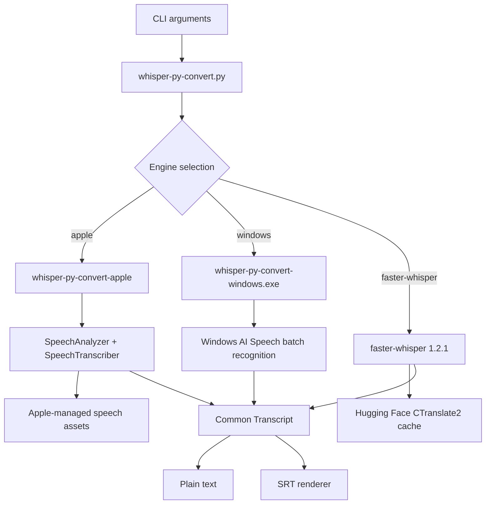
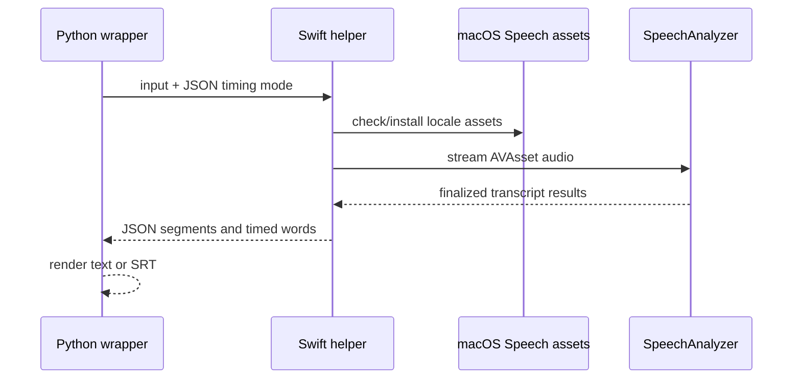
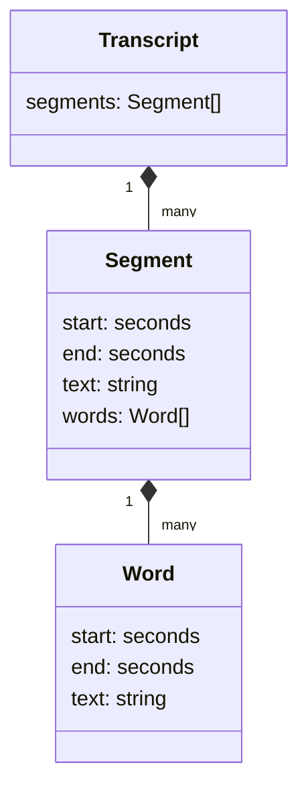
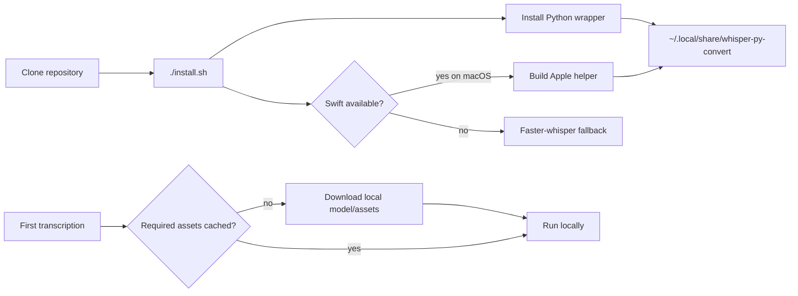

# Architecture and extension guide

This page documents the preserved **legacy STT dispatcher**. The broader
`mac-speech` package, independent TTS engine, workflows, packaging, and
verification boundaries are described in [docs/architecture.md](docs/architecture.md).
Phase 12 does not replace or modify the legacy STT contract.

## Runtime flow



The Python file is the stable command-line boundary. It owns argument parsing,
engine selection, output-file handling, and stdout/stderr behavior. Backend
implementations return plain transcript text; they should not write progress to
stdout because users may redirect stdout to a transcript file.

## Engine selection

`--engine auto` is the default. It selects Apple when the native executable is
present, then Windows when its helper is installed, otherwise faster-whisper.
Explicit selection is available for testing
and reproducibility:

```sh
whisper-py-convert --engine apple recording.mp4
whisper-py-convert --engine windows recording.wav
whisper-py-convert --engine faster-whisper --model small.en recording.mp4
```

The Apple backend does not expose Whisper model names. macOS selects and
manages the appropriate speech model for the requested locale. The first use
of a locale may download Apple speech assets; audio processing is local after
the assets are installed.

## Apple backend lifecycle



`Sources/WhisperAppleTranscribe/main.swift` performs these steps:

1. Validate the input path; acquire the cooperating per-user STT lock and resolve
   `SpeechTranscriber.supportedLocale(equivalentTo:)` (report regional substitution).
2. Reserve the supporting asset locale. `false` means reuse, not unsupported.
   Identify newly-owned reservations from the actual inventory delta, then create
   the transcriber and check/install its Apple-managed assets.
3. Create an `AVAsset` and `AssetInputSequenceProvider`, allowing audio/video
   containers such as MP3 and MP4 to be decoded by the system.
4. Feed the provider sequence into `SpeechAnalyzer`.
5. Consume finalized `SpeechTranscriber` results and write them to stdout.
6. On error/cancellation, stop the analyzer and await the result collector before
   releasing newly-owned reservations. On success await collection/output/cleanup.
   Borrowed pre-existing reservations are never released. Unlock only afterward.

The root source manifest requires Swift tools **6.4**. The target is macOS 27 because `AssetInputSequenceProvider` and the current
audio/video sequence path are macOS 27 APIs. The Apple backend is therefore
optional; the Python/faster-whisper path remains the fallback on older macOS
versions and other operating systems.

The separately authorized [risk #19 repair](docs/stt-reservation-repair.md)
corrects both the original missing release and false-return interpretation.
Capacity is device-specific `maximumReservedLocales`, not a five-recording quota.
The gate serializes cooperating CLI processes across locales (reduced parallel
STT throughput); it does not coordinate old binaries or other app clients.
SIGINT/SIGTERM request cancellation and await cleanup; SIGKILL/power loss cannot.
`--inventory-status [--language ...]` is a read-only diagnostic in this binary's
identity. Full existing inventory is not automatically reset. Real newly-owned
cleanup/recovery remains unverified until capacity is available; risk is partial.

The uncommitted follow-up adds locked maintenance inspect/preview and separately
confirmed exact-target release, with optional native installed/exact/new validation
guards. Owned cleanup/readback is cancellation-isolated and **fully awaited**;
no detached work survives gate release. Default en-US and other English regions
remain supported. See [maintenance safety](docs/stt-reservation-maintenance.md).

The Windows helper is an optional MSIX-packaged C# executable. It uses Windows
AI Speech batch recognition on supported Windows 11 24H2+ hardware. It
currently returns plain text; timed subtitle output should use faster-whisper
until the Windows API exposes the required timing metadata in a stable release.

## Timestamp model



The Python layer normalizes timed backends into:

```text
Transcript
└── segments: start, end, text, words
    └── words: start, end, text
```

`--srt --seg-ts` renders one subtitle cue per segment. `--srt --word-ts`
renders one cue per timed word. Faster-whisper computes word timings with its
word-timestamp option. Apple emits `SpeechTranscriber` attributed text with
`audioTimeRange` attributes, which the Swift helper serializes as JSON for the
Python renderer.

## Adding another backend

Keep the backend contract small:

1. Add a new CLI value to `--engine`.
2. Add `find_<backend>_binary()` or a dependency check.
3. Add `transcribe_with_<backend>(args) -> Transcript`.
4. Call it from `main()` and keep diagnostics on stderr.
5. Document installation, privacy, model/assets, and offline behavior.
6. Add a short deterministic smoke test to the verification section below.

Do not make the Python wrapper depend on Apple-only imports. Do not make the
Apple binary depend on Python or faster-whisper.

## Installation and caches



`install.sh stt` copies the Python entrypoint and, on a Mac with a compatible
Swift toolchain/SDK, attempts to build and copy the Apple executable into:

```text
~/.local/share/whisper-py-convert/
~/.local/bin/whisper-py-convert -> .../whisper-py-convert.py
```

The diagram above describes the STT portion only. The default `all` mode also
builds TTS independently; `tts` skips the Apple STT build but still copies the
legacy script/symlink. Python package installation is separate. Paths honor
the installer's XDG overrides; see [installation](docs/installation.md) for
discovery limits and build warnings (installer exit 0 alone is not build proof).

The faster-whisper package is pinned to `1.2.1` and is installed lazily. Its
models are cached by Hugging Face under `~/.cache/huggingface/hub`. An optional
`HF_TOKEN` is passed to the Hugging Face client without being printed or
stored by this project.

## Verification

From the repository directory:

```sh
python3 -m py_compile whisper-py-convert.py
swift build --configuration release
python3 whisper-py-convert.py --check
```

For a local Apple smoke test without a private recording:

```sh
say -o /private/tmp/whisper-py-convert-test.aiff \
  'This is a local transcription test.'
python3 whisper-py-convert.py --engine apple \
  /private/tmp/whisper-py-convert-test.aiff
```

The first Apple run may install speech assets. A second run should not repeat
the asset-installation message. To test the fallback explicitly, use
`--engine faster-whisper --model small.en`; that can install packages/download
models and is not an offline packaging smoke test. The Apple smoke can fail
for risk #19; do not treat the check command as successful transcription.
For Phase 12 wrapper/TTS verification use
[the clean-install checks](docs/verification.md) and `bash scripts/ci_swift.sh`
(the latter builds/tests only the independent TTS package).
