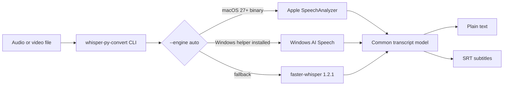
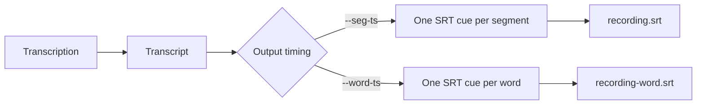

# whisper-py-convert

A standalone command-line wrapper with native and portable local transcription backends:

- Apple SpeechAnalyzer/SpeechTranscriber on macOS 27+
- Windows AI Speech on supported Windows 11 24H2+ systems
- `faster-whisper==1.2.1` everywhere else

It supports audio/video formats including MP3 and MP4.

> **This repository also contains the `mac-speech` toolkit**, locally
> verified through Phase 12: independent native TTS, a shared STT adapter,
> artifact/narration workflows, and explicit optional exporters.
> `whisper-py-convert` remains the preserved, independent transcription CLI;
> its known Apple locale-reservation limitation is not repaired by the toolkit.
> See [current architecture](docs/architecture.md), [the Python package](python/README.md),
> and [the phased plan](PLAN.md).

## Local speech toolkit quickstart

For **TTS only**, build the independent native engine and install the small
Python wrapper into its own environment (macOS; Swift 6.4+ to build):

```sh
./install.sh tts
python3 -m venv .venv
.venv/bin/python -m pip install .
.venv/bin/mac-speech capabilities --json
.venv/bin/mac-speech tts save "Hello from my Mac." --output ./hello.wav --manifest
```

The base wrapper has **no third-party runtime dependencies**. Speech uses
locally installed Apple voices/assets; it does not need cloud credentials.
Installing a new voice/locale or selecting the legacy faster-whisper backend
can require separate downloads—neither is part of the offline smoke test.
`tts` mode skips the STT native build, but still installs the existing legacy
wrapper script; it never removes an existing STT installation.

- [Installation, supported versions, uninstall, and troubleshooting](docs/installation.md)
- [Packaging, integrity checks, and signing limitations](docs/packaging.md)
- [Small narration workflow and explicit optional export](examples/README.md)
- [Clean-install and network-denied verification](docs/verification.md)
- [CI coverage and toolchain requirements](docs/ci.md)
- [Dependency/license inventory](docs/sbom.md) and [release checklist](docs/releasing.md)
- [Phase 13A workspace/output safety and upgrade instructions](docs/phase13-hardening.md)
- [Phase 13B bounded local scene batches](docs/batch-synthesis.md)
- [Apple STT reservation repair, one-at-a-time admission and remaining limits](docs/stt-reservation-repair.md)
- [Safe reservation maintenance previews and native offline validation](docs/stt-reservation-maintenance.md)
- [Apple language readiness and explicit asset setup before transcription](docs/apple-asset-setup.md)

The current Apple helper checks language readiness before analysis and does not
silently download assets during transcription. Missing assets produce an explicit
setup command; confirm it only when you approve any needed Apple model download.
Use matching updated Python/native versions; source/wheel installation does not
silently update an old installed helper. Device-specific reservation capacity is
not a recording/process quota.

The toolkit is **source-available under a custom proprietary personal-use,
non-commercial, no-derivatives license**, not OSI-approved open source.
See [LICENSE](LICENSE) and [licensing guidance](docs/licensing.md) for the
grant, restrictions, unchanged-source build allowance and separate third-party
terms. No PyPI publication, signed binary release, or notarization is implied.

## How it works



The project keeps one command-line interface while selecting the best local
engine available on the machine.

## Install the command

From this directory:

```sh
./install.sh
```

On macOS 27+, the installer also builds the native Apple Speech backend. On
macOS with a suitable Swift toolchain, its default `all` mode also builds the
independent TTS engine. On older macOS the STT build may warn/fail while TTS
can still build; non-macOS systems receive the legacy Python wrapper only.
Use `./install.sh stt` for only the native STT build. This installer does not
install the `mac-speech` Python package; faster-whisper is installed by the
legacy dispatcher on first use if needed.

Then open a new shell, or add `~/.local/bin` to `PATH` as printed by the
installer. The command can then be run from any directory.

## Check installation and models

```sh
whisper-py-convert --check
```

The first faster-whisper invocation installs the exact `faster-whisper==1.2.1`
package if it is missing or a different version is installed. Whisper models
are downloaded lazily when first selected and cached under
`~/.cache/huggingface/hub`. The Apple backend downloads and manages its own
system speech assets through macOS.

For authenticated Hugging Face downloads, set the token in the environment:

```sh
export HF_TOKEN=hf_your_token_here
whisper-py-convert --model small.en recording.mp3 > transcript.txt
```

The token is passed only to the Hugging Face download client and is never
printed or saved by this tool. It is optional for these public models; it can
help avoid anonymous rate limits, but it does not guarantee a faster network
transfer.

## Transcribe

Print only the transcript to stdout, suitable for shell redirection:

```sh
whisper-py-convert --model small.en recording.mp3 > transcript.txt
whisper-py-convert --model medium.en recording.mp4 > transcript.txt
```

Or let the tool write the file:

```sh
whisper-py-convert --model small.en recording.mp3 --output transcript.txt
```

Choose a backend explicitly:

```sh
whisper-py-convert --engine apple recording.mp4 > transcript.txt
whisper-py-convert --engine windows recording.wav > transcript.txt
whisper-py-convert --engine faster-whisper --model small.en recording.mp4 > transcript.txt
```

`--engine auto` is the default. It uses the Apple backend when the native
binary is installed, then the Windows backend when its helper is installed,
and otherwise uses faster-whisper. Native OS backends do not use `--model`.

## Subtitle timestamps



Segment-level SRT:

```sh
whisper-py-convert recording.mp4 --srt --seg-ts > recording.srt
```

Word-level SRT:

```sh
whisper-py-convert recording.mp4 --srt --word-ts > recording-word.srt
```

`faster-whisper` supplies explicit segment and word timings. Apple’s backend
uses `SpeechTranscriber` audio-time-range attributes for word timings. The
Windows native backend currently returns plain text only, so use
faster-whisper for timed subtitles on Windows.

Use `--language en` when the recording is known to be English. Omit `.en`
models for multilingual recordings.

## Notes

- `small.en` is the recommended default for English.
- `medium.en` uses more memory and takes longer to load, but can improve
  accuracy.
- Apple SpeechAnalyzer processes speech locally with Apple-managed system
  assets. The audio is not sent to Apple servers by the new transcriber API.
- Only the selected model is loaded into memory. You can keep both models
  downloaded and switch with `--model`.
- Progress messages go to stderr, leaving stdout clean for transcript output.
- The existing Apple STT engine can exhaust its five-locale reservation quota
  and report `does not support locale`. This remains open as
  [risk #19](docs/risk-register.md); engine discovery does not prove successful
  transcription, and four native regression fixtures currently skip for it.

## Backend comparison

| Backend | Runs locally | Audio/video files | Segment timing | Word timing | Main requirement |
| --- | --- | --- | --- | --- | --- |
| Apple SpeechAnalyzer | Yes | Yes | Yes | Yes | macOS 27+ |
| Windows AI Speech | Yes | Yes | Not exposed by current helper | Not exposed by current helper | Windows 11 24H2+, supported hardware, MSIX |
| faster-whisper | Yes | Yes | Yes | Yes | Python and downloaded Whisper model |

## Project layout

```text
Package.swift                         Swift package for the Apple backend
Sources/WhisperAppleTranscribe/       Swift SpeechAnalyzer CLI
windows/                              Optional Windows AI Speech helper
engines/tts-swift/                     Independent native TTS Swift package
python/mac_speech/                    Shared Python API and mac-speech CLI
pyproject.toml, MANIFEST.in            Python-only wheel/sdist packaging
tests/, scripts/, .github/workflows/   Tests, offline helpers, and CI configuration
docs/, examples/                      Toolkit contracts and runnable examples
BROWSER.md                            Deferred browser-local design notes
whisper-py-convert.py                 Cross-platform Python dispatcher
install.sh                            Native stt/tts/all modes and legacy command
```

The Python dispatcher is intentionally the stable CLI boundary. Future
backends can implement a new `transcribe_with_<engine>` function and be added
to `--engine` without changing the output, redirection, or installation model.
See [ARCHITECTURE.md](ARCHITECTURE.md) for the backend contract and extension
guide.

## Prerequisites

- Python 3.9+ for the Python wrapper and faster-whisper backend
- macOS 27+ and Swift 6.4+ with a suitable Apple SDK for the Apple backend
- Native TTS targets macOS 13+ (Personal Voice APIs macOS 14+), also requiring
  Swift 6.4+ to build; only macOS 27.0.1 arm64 native execution is verified
- Windows 11 24H2+, Windows App SDK, supported hardware, and MSIX packaging for
  the Windows native backend; see [windows/README.md](windows/README.md)
- Network access only when installing packages or downloading first-use model
   assets; transcription itself is local after the assets are installed

## Current verification boundary

Phase 12's independent local checks recorded **322 Python tests passed,
4 native STT skips** on Python 3.11.3; mocked source tests passed **322 each**
on 3.12.5/3.13.7/3.14.8. The extracted sdist passed **311 tests, 15 skipped**.
Package/helper Ruff and 16-file scoped strict mypy passed; isolated Swift
checks passed **39 tests** and a release build. A clean 3.11.3 wheel and real
TTS-only install passed network-denied, credential-free smoke and focused
uninstall/restore checks. These are local results, not a hosted-CI or successful
native-STT claim. See [verification](docs/verification.md) and [CI scope](docs/ci.md).
